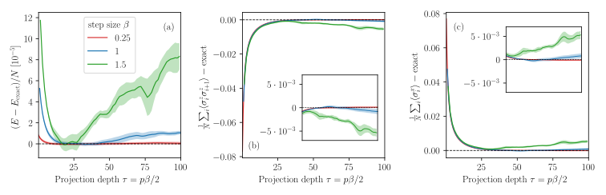
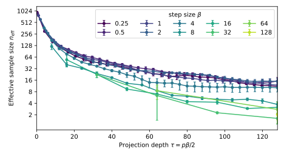

.. _GoodSimulation:

#########################
Running a good simulation
#########################

It can be difficult to obtain well-equilibrated results for hard problems (such as the :ref:`ferromagnet-spin-liquid transition on the pyrochlore lattice <pyrochlore-transition>`).
It is therefore important to identify the problems in order to mitigate them.

.. admonition:: Two sources of error

    * The algorithm has a **systematic error** coming from the finite projection depth.
      The projection depth is defined by :code:`step_size` (denoted by :math:`\beta` in the following) times the number of branching steps :math:`p`, divided by two:

      .. math::

          \tau = \frac{p}{2}\,\beta\,.

      :math:`\beta` is an integer for the discrete methods and a floating-point number for the continuous-time method.
      The :math:`\tau` values from the two methods should not be compared directly.

    * It further exhibits **statistical errors** coming from two origins.
      First, a finite number of measurements leads to statistical noise, which becomes problematic when the measurements are strongly autocorrelated.
      Second, the effective walker population collapses at large projection depth.
      After :math:`p` branching steps, the entire population traces back to only a few ancestor configurations, or to a single one.

The effects of these errors become visible when the energy or an observable is tracked as a function of :math:`p` over several independent runs.
In a healthy simulation, every run converges to the same plateau, signaling that the projection has reached the ground state and that the statistical errors are small.
If :math:`p` is increased further, the plateau eventually deteriorates.
There the algorithm fails because the population has collapsed to too few ancestors.

We illustrate the convergence for the critical spin-1/2 TFIM with :math:`N = 100` sites (data of Fig. 4 of the :ref:`paper <Paper>`).
Each panel shows the difference to the exact value per site: energy (a), nearest-neighbor correlator (b), and transverse magnetization (c).
Panel (c) is not measured separately: the energy is a linear combination of the correlator and the transverse magnetization, so (c) follows from (a) and (b).

.. _fig-convergence:

The figure shows data for three different step sizes, :math:`\beta = 0.25` (red), :math:`\beta = 1` (blue) and :math:`\beta = 1.5` (green).
:math:`\beta = 0.25` is clearly superior, leading to a stable plateau for the entire projection depth of :math:`\tau=100`.
The step size can be used to improve the convergence at larger projection depth.
This is discussed in :ref:`Tuning the step size <tuning-step-size>`.
We find that the energy converges faster than the correlator and is more stable.

Finite projection depth
=======================

To check whether the projection depth is sufficient, track the observable of interest as a function of :math:`p`.
If it settles on a plateau that is stable over several consecutive :math:`p`, the projection has converged.
If it keeps moving, increase :math:`p`.
Check each observable separately, as the energy usually converges at much smaller :math:`p` than other observables.
A better guiding wavefunction reduces the projection depth needed.

In the :ref:`convergence figure <fig-convergence>` above, the plateau is reached only for :math:`\tau \gtrsim 25` for the observables.

Statistical errors
==================

The most important error source is the collapse of the effective sample size, caused by the branching of walkers.
A few lineages of ancestors (or a single one) dominate the reconfiguration and reduce the effective sample size.
This collapse is why the plateau in the :ref:`convergence figure <fig-convergence>` deteriorates at large :math:`\tau`.

We define the effective sample size after :math:`m` branching steps as

.. math::

    n_\mathrm{eff}(m) = \frac{N_\mathrm{walker}^2}{\sum_i c_i(m)^2} \in [1, N_\mathrm{walker}]\,,

where :math:`c_i` is the number of walkers descending from the :math:`i`-th initial walker after :math:`m` steps.
Note that an observable evaluated at :math:`p` requires only :math:`m = p/2` branching steps.
We recommend :math:`n_\mathrm{eff} \gtrsim 50` to get good statistics.

Every :code:`run` reports the effective sample size in :code:`stats`, at :math:`m = p/2` for each window of :code:`p_array`:

.. code-block:: python

    walkers, energy, obs, stats, raw = run(
        walkers, n_steps=2000, hamiltonian=H, step_size=0.2,
        guide=guide, p_array=[2, 4, 8, 16], rng_key=jax.random.PRNGKey(1),
        warmup_steps=1000, verbosity=0,
    )
    for m, n_eff in zip(stats["ancestor_m"], stats["effective_sample_size"]):
        print(f"p = {2 * int(m):3d}   n_eff = {n_eff:8.1f}")

It can also be computed using :func:`~pygfmc.engine.statistics`, without a production run, for any values in :code:`m_array`:

.. code-block:: python

    from pygfmc import statistics

    _, st = statistics(walkers, H, step_size=0.2, guide=guide, method="cont_time",
                       rng_key=jax.random.PRNGKey(7), m_array=[1, 5, 10, 20, 40],
                       quiet=True)
    for m, n_eff in zip(st["ancestor_m"], st["effective_sample_size"]):
        print(f"m = {int(m):3d}   n_eff = {n_eff:8.1f}")

Another source of statistical noise is simply an insufficient number of measurements.
While we recommend running independent Markov chains to identify this, :func:`~pygfmc.engine.evaluate_observables` provides the possibility to estimate the error bars of a single run with a blocked jackknife:

.. code-block:: python

    from pygfmc import evaluate_observables

    E, O, E_err, O_err = evaluate_observables(raw, n_blocks=20)
    for p in E:
        print(f"p = {p:3d}   E/L = {E[p] / L:.6f} +- {E_err[p] / L:.6f}")

.. _tuning-step-size:

Tuning the step size
====================

Apart from a better guide and more walkers, the step size :math:`\beta` is the most important knob for improving a calculation.
To optimize it, choose a target projection depth :math:`\tau = p\beta/2` and measure :math:`n_\mathrm{eff}` as a function of :math:`\tau` for several :math:`\beta`.
The optimal :math:`\beta` gives the largest :math:`n_\mathrm{eff}` at the target :math:`\tau`:

.. code-block:: python

    import numpy as np
    import matplotlib.pyplot as plt
    from pygfmc import statistics

    tau_max = 128.0                                      # target projection depth
    betas   = [0.25, 0.5, 1, 2, 4, 8, 16, 32, 64, 128]  # step sizes to compare
    seeds   = range(2)                                   # independent repetitions
    colors  = plt.cm.viridis(np.linspace(0, 0.9, len(betas)))

    fig, ax = plt.subplots(figsize=(6.5, 3.6))
    for beta, color in zip(betas, colors):
        m_max   = round(tau_max / beta)
        m_array = np.unique(np.linspace(1, m_max, 32).round().astype(int))
        n_eff   = np.array([
            statistics(walkers, H, guide=guide,
                       avg_log_weight=stats["avg_log_weight"], step_size=beta,
                       method="cont_time", rng_key=jax.random.PRNGKey(seed),
                       m_array=m_array, quiet=True)[1]["effective_sample_size"]
            for seed in seeds])
        tau = m_array * beta                             # tau = (p/2) * beta = m * beta
        ax.errorbar(tau, n_eff.mean(axis=0),
                    yerr=n_eff.std(axis=0, ddof=1) / np.sqrt(len(seeds)),
                    fmt="o-", ms=4, capsize=2, color=color, label=f"{beta:g}")

    ax.set_xlabel(r"Projection depth $\tau = p\beta/2$")
    ax.set_ylabel(r"Effective sample size $n_\mathrm{eff}$")
    ax.set_yscale("log")
    ax.set_yticks([2**k for k in range(1, 11)], [str(2**k) for k in range(1, 11)])
    ax.minorticks_off()
    ax.set_xlim(0, tau_max)
    ax.legend(title=r"step size $\beta$", loc="upper right", ncol=5)
    fig.tight_layout()
    fig.savefig("neff_vs_tau.pdf")

Step sizes from :math:`\beta = 0.25` to :math:`2` give nearly the same :math:`n_\mathrm{eff}` up to :math:`\tau \approx 60`; at the largest depths :math:`\beta = 0.25` and :math:`0.5` keep slightly more.
If multiple values lead to similarly good results, use the largest one for a shorter runtime.

Further tips
============

* **Equilibrate.** Do an equilibration run first.
  The :code:`run` function has the option to set :code:`warmup_steps`.
* **Start in the right sector.** If the Hamiltonian conserves a quantity, all walkers must be within the sector of interest (see :ref:`Prepare walkers <usage-walkers>`).
* **Use many walkers.** The more walkers, the better.
* **Off-diagonal observables.** Use :code:`off_diag_stride` to reduce the autocorrelation time between measurements.
* **Discrete methods.** If no diagonal element is present (e.g., pure hopping), we recommend working with the discrete method using :code:`method="single_step"`.
* Check if a GPU is used:

  .. container:: center

     :code:`python -c "import jax; print(jax.default_backend(), jax.devices())"`

.. admonition:: Invest in the guide

    More walkers help, but a better :ref:`guiding wavefunction <usage-guide>` is usually the more effective investment.
    See the :download:`kagome notebook <../notebooks/kagome_xxz.ipynb>`.
