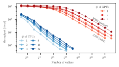
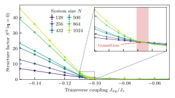

.. _PyGFMC:

###################
Welcome to PyGFMC!
###################

.. admonition:: **Py**\ thon **G**\ reen's **F**\ unction **M**\ onte **C**\ arlo (**PyGFMC**)

    PyGFMC is a `JAX <https://jax.readthedocs.io>`_-based implementation of Green's Function Monte Carlo for ground states of sign-problem-free quantum lattice models. It

    * runs efficiently on **GPUs**,
    * provides access to **diagonal** and **off-diagonal** observables, and
    * accepts **arbitrary variational wavefunctions** as guides.

    Install it from `PyPI <https://pypi.org/project/pygfmc/>`_ with :code:`pip`:

    .. code-block:: console

        pip install pygfmc               # GFMC only
        pip install "pygfmc[netket]"     # + training guides with NetKet

What is Green's Function Monte Carlo?
-------------------------------------

GFMC is a projection method on the ground state :math:`\vert\psi_0\rangle` of a sign-problem-free Hamiltonian :math:`H`:

.. math::

    \vert\psi_0\rangle \;\propto\; \lim_{n\to\infty}\,e^{-n\beta H} \,\vert\psi\rangle\,.

Evaluating this projection stochastically gives access to both **diagonal** and **off-diagonal** observables.

A key advantage compared to other Monte Carlo methods is the use of a **guiding wavefunction**, which is an approximation of the ground state that improves the sampling.
The better the ansatz, the more effective the method becomes.

.. admonition:: Training guides with NetKet

    PyGFMC is built on `JAX <https://jax.readthedocs.io>`__ and connects naturally to `NetKet <https://netket.readthedocs.io>`__, which we use to optimize arbitrary guides, including large **neural quantum states**.

GPU acceleration
----------------

The `JAX <https://jax.readthedocs.io>`_ implementation provides GPU speedups of up to **three orders of magnitude!**

   Throughput (iterations per second) versus the number of walkers on CPU cores and on A100 and H200 GPUs (Fig. 3 of the :ref:`Paper <Paper>`).
   The number of walkers sets the size of the simulation.

This speedup makes it possible to tackle problems that are extremely difficult to equilibrate!
The figure below resolves the transition between the ferromagnet and **quantum spin ice** in the three-dimensional pyrochlore lattice:

.. _pyrochlore-transition:

   Transverse structure factor :math:`S^{\pm}(\mathbf{q}=0)` of the nearest-neighbor pyrochlore XXZ model versus :math:`J_{xy}/J_z` for system sizes up to :math:`N=1024` (Fig. 6 of the :ref:`Paper <Paper>`).
   The transition sits at :math:`J_{xy}/J_z=-31/300\pm 1/1200`.

The setup
---------

A PyGFMC simulation is built from four components:

* a :ref:`Hamiltonian <usage-hamiltonian>`,
* an initial :ref:`walker ensemble <usage-walkers>`,
* an optional :ref:`guiding wavefunction <usage-guide>`, and
* an optional set of :ref:`observables <usage-observables>` to evaluate.

:ref:`Running a simulation <Usage>` includes a step-by-step guide.
See the :ref:`Paper <Paper>` for more details and an explanation of the algorithm.

.. _quickstart-guide:

Quickstart
----------

The example below simulates the Bose-Hubbard chain with at most two bosons per site,

.. math::

    H = -\sum_i \left[ t \left(b^\dagger_i b_{i+1} + \mathrm{h.c.}\right)
        + \eta \left(b^\dagger_i b^\dagger_{i+1} + \mathrm{h.c.}\right) \right]
        + \frac{U}{2}\sum_i n_i(n_i-1) - \mu\sum_i n_i\,,

guided by a Gutzwiller-Jastrow wavefunction,

.. math::

    \log\psi_T(x) = -\beta\sum_i x_i x_{i+1} + h\sum_i x_i - d\sum_i x_i^2\,,

where :math:`x_i` is the occupation of site :math:`i`.

.. code-block:: python

    import jax
    from pygfmc import run
    from pygfmc.walkers import prepare_walkers_sz
    from pygfmc.hamiltonian import BoseHubbard
    from pygfmc.wavefunction import JastrowBoseHubbard, train_with_netket
    import netket as nk

    L       = 50
    edges   = [[i, (i + 1) % L] for i in range(L)]   # periodic chain

    H       = BoseHubbard.create(edges, t=1.0, eta=0.25, U=4.0, mu=1.0, n_max=2)
    walkers = prepare_walkers_sz(512, L, jax.random.PRNGKey(0), sz=L, states=(0.0, 1.0, 2.0))

    # variational optimization of beta, h and d with NetKet (stochastic reconfiguration)
    guide   = JastrowBoseHubbard(L, edges, beta=0.0, h=0.0, d=0.5)
    sampler = nk.sampler.MetropolisLocal(nk.hilbert.Fock(n_max=2, N=L))   # pair term: N not conserved
    guide, history = train_with_netket(H, guide, sampler=sampler, n_iter=50, learning_rate=0.05,
                                       sr=True, qgt=nk.optimizer.qgt.QGTJacobianDense,
                                       return_history=True)
    print(f"beta = {float(guide.beta[0]):.3f}, h = {float(guide.h[0]):.3f}, d = {float(guide.d[0]):.3f}")
    print(f"variational energy per site: {history[-1] / L:.5f}")

    walkers, energy, obs, stats, raw = run(
        walkers, n_steps=2000, hamiltonian=H, step_size=0.25,
        guide=guide, p_array=[8, 16, 32, 64], rng_key=jax.random.PRNGKey(1),
        warmup_steps=1000, verbosity=10
    )

    print({p: e / L for p, e in energy.items()})    # energy per site, DMRG: -2.026343

Content
-------

.. toctree::
    :maxdepth: 2

    About the algorithm <GFMC>
    paper.rst
    installation.rst
    usage.rst
    good_usage.rst
    examples.rst
    api.rst
